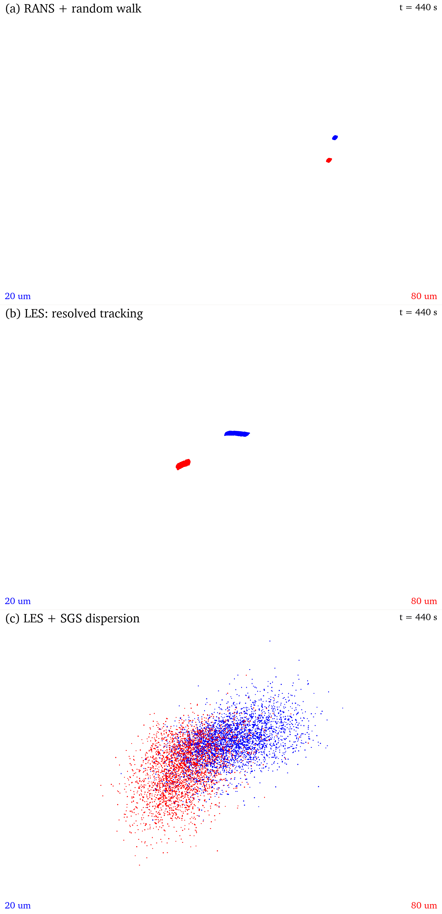

# 亚格子扩散模型

用于 OpenFOAM v2606 的 LES 颗粒追踪，补充网格未解析的小尺度湍流对颗粒的作用。参考 [Comola 等（2019）](https://doi.org/10.1029/2018JD029614) 的 SGS 随机模型。

## 编译

加载 OpenFOAM 环境后，在仓库目录运行：

```bash
wmake libso src
```

## 使用

在 `system/controlDict` 中加载库：

```foam
libs ("libsgsDispersion.so");
```

在 `constant/kinematicCloudProperties` 的 `subModels` 中选择模型：

```foam
dispersionModel sgsDispersion;
sgsDispersionCoeffs
{
    averagingTime 400;
    C0 4;
    beta 2;
    cEpsilon 0.93;
    verticalDirection (0 0 1);
    stationaryInitial false;
}
```

`averagingTime` 为统计时长，单位 s，可取域高除以摩擦速度。本例为 120/0.3=400 s，在统计达到该时长后释放颗粒。重启后需重新积累统计。

## 三组算例

| 目录 | 设置 |
|---|---|
| `cases/RANS_DRW` | 固定风速、k、epsilon 剖面，随机游走 |
| `cases/LES_resolved` | LES 颗粒追踪 |
| `cases/LES_SGS` | LES 颗粒追踪，启用 SGS 模型 |

三组均采用球形颗粒阻力 `schillerNaumannDrag` 和重力，颗粒直径为 20、80 μm。

```bash
mkdir -p "$FOAM_RUN/sgsDispersion"
cp -r cases/* "$FOAM_RUN/sgsDispersion/"
cd "$FOAM_RUN/sgsDispersion/LES_SGS"
blockMesh
kinematicParcelFoam
```

其他两组进入对应目录运行相同命令。

## 对比结果



蓝色：20 μm；红色：80 μm；t=440 s。图示 LES 的数字滤波入口含本机修改。
